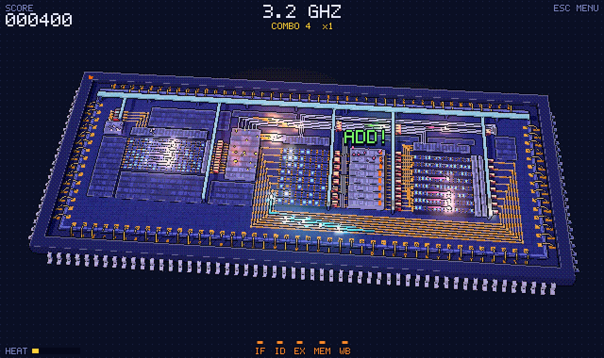
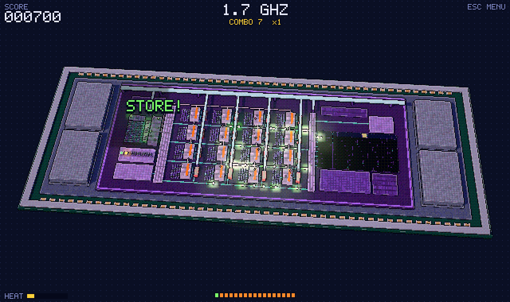

# Overclock

**Sei tu il clock.** Un gioco arcade in pixel art 3D su come funzionano davvero i processori: ogni tocco è un colpo di clock, e dopo ogni colpo i bit corrono verso i registri. Devi dare il colpo seguente quando sono arrivati tutti. Troppo presto e i latch catturano bit sbagliati; troppo tardi e perdi tempo.

**▶ Gioca: <https://angeloquartarone.github.io/overclock/>**: funziona in qualsiasi browser recente, su computer e telefono, e si può installare come app che gioca anche offline. La lingua (inglese o italiano) si sceglie nelle Impostazioni.



*[English](README.md) · Italiano*

- **Troppo presto**: i latch catturano bit che non sono ancora arrivati. È un glitch: perdi una vita e il valore sbagliato prosegue *davvero* nella pipeline, fino ai registri o alla memoria, che diventano rossi.
- **Appena in tempo**: `PERFETTO!` (entro 0,1 s da quando l'ultimo bit è arrivato) o `BUONO` (entro 0,3 s). La combo sale e con lei il moltiplicatore, fino a ×4.
- **Troppo tardi**: `LENTO`, pochi punti e la combo si azzera.

Tre glitch e il processore va in `CRASH!`. Ogni 20 colpi di fila in tempo (perfetti o buoni) recuperi una vita.

## Processori

Ci sono cinque processori, ognuno con il suo chip e una regola presa da come funziona davvero. Si sceglie dopo *Gioca*, e il chip dietro al menu cambia mentre si passano.

| Processore | Com'è davvero | Cosa cambia nel gioco | Il chip |
|---|---|---|---|
| **Ciclo singolo** | un'istruzione intera per colpo di clock, senza registri tra gli stadi | a ogni colpo un'onda sola attraversa tutto il chip, e l'occhio di bue la segue. Il ritmo è lento e irregolare (da 0,5 a 1,1 s, la LOAD con il `MISS` di più). A fine partita: quanto ci avrebbe messo un clock fisso, tarato sull'istruzione più lenta | DIP di ceramica bianca, die dorato |
| **Multi-ciclo** | l'istruzione è spezzata in passi; una sola memoria per istruzioni e dati e una sola ALU, riusate; il controllo è una macchina a stati | un colpo per passo: 4 per le operazioni (IF ID EX WB), 5 per la LOAD, 4 per la STORE. Le 5 spie sull'unità di controllo mostrano il percorso dell'istruzione e il passo in corso; l'accordo si chiude solo all'ultimo passo. A fine partita il CPI | PGA di ceramica grigia, die verde acqua |
| **Pipeline** | cinque istruzioni insieme, una per stadio | il gioco originale | QFP, die blu |
| **Microcontrollore** | dorme quasi sempre, va a batteria, si sveglia con gli interrupt | un piedino si accende (`IRQ!`), l'oscillatore riparte e dai il clock alla routine di interrupt (la prima battuta preleva il vettore, poi 4 istruzioni) entro la scadenza, se no `OVERRUN!` e perdi una vita. Dopo `RETI` torna a dormire: un colpo dato mentre dorme (`DORME!`) spreca batteria e azzera la combo. Al posto del calore c'è la batteria: ogni colpo consuma, di più se corri; quasi scarica rallenta il chip, a zero è `BROWN-OUT!` | DIP di plastica nera, periferiche sul bordo |
| **GPU** | tante corsie semplici eseguono la stessa istruzione su dati diversi; si aspetta sempre la più lenta | ogni colpo manda un'istruzione a 16 corsie, che finiscono in momenti diversi: tocchi quando sono verdi tutte. Lo shader colora una riga di un'immagine (un'astronave al tramonto) e la scrive nel framebuffer sul chip; otto righe fanno un `FRAME!` (bonus). Con l'"if" le corsie che non lo eseguono restano spente (divergenza). Un glitch lascia pixel sbagliati: gli artefatti | BGA con quattro pile di memoria HBM, senza fili d'oro |



Le frequenze in alto sono equivalenze giocose, ognuna nell'unità del suo processore (MHz per i più vecchi e per il microcontrollore, GHz per pipeline e GPU).

## Modalità

| Modalità | Regole | In classifica |
|---|---|---|
| **Classica** | 60 secondi, 3 vite | i punti |
| **Sprint 50** | 50 istruzioni corrette, 3 vite | il tempo, solo se arrivi in fondo |
| **Sopravvivenza** | niente tempo limite. Il *watchdog* concede un ritardo massimo dopo l'arrivo dei bit, che parte da 1 s e scende fino a 0,28 s: se lo superi dà lui il colpo di clock e perdi una vita | i punti |
| **Allenamento** | niente vite né tempo, con le spie degli stadi in basso | non si salva |
| **Sfida del giorno** | una Classica con lo stesso programma per tutti, che cambia ogni giorno; anche il processore cambia ogni giorno. Si gioca anche offline | il miglior punteggio di oggi |
| **Sfide tra amici** | chi crea la sfida sceglie processore e modalità e riceve un codice di 5 caratteri (o un link `?sfida=CODICE`). Tutti giocano lo stesso programma (serve un server dei punteggi) | il migliore di ognuno nella sfida |

"Lo stesso programma" vuol dire stesso seme: stesse istruzioni, stessi dati iniziali e stessi `MISS` della memoria. Dopo un glitch i dati cambiano davvero, quindi le partite si allontanano.

## Cosa rende il ritmo difficile (ed è tutto vero)

| Cosa | Perché |
|---|---|
| Le **somme** con tanti riporti sono più lente | l'ALU è un sommatore a propagazione del riporto: ogni fetta aspetta il riporto da quella sotto. `0x7F + 1` è molto più lenta di `0x10 + 0x01`. XOR, AND e OR invece sono rapide. |
| Le **LOAD** dipendono da dove sta il dato | le colonne lontane della memoria hanno fili più lunghi. Dopo 20 secondi a volte la memoria "manca" il dato (`MISS!`) e bisogna aspettare 0,7 secondi in più. |
| Il **calore** rallenta tutto | più alta è la frequenza, più il chip scalda (diventa arancio e rosso), e il silicio caldo è più lento. Se corri troppo, i bit arrivano sempre più tardi. |
| Anche le istruzioni e i registri contano | l'istruzione da prelevare e il registro da leggere stanno più o meno lontano dai latch. |
| Nella GPU, la corsia più lontana | ogni corsia ha i suoi riporti, e quelle lontane dalla cache delle texture o dalla ROP ricevono e scrivono più tardi. |
| Nel microcontrollore, la periferica | `IN` e `OUT` viaggiano sul bus delle periferiche: il pulsante e il timer stanno più lontano dell'ADC. |

## Si gioca guardando il chip

- **I registri di pipeline**: quattro file di latch, una alla fine di ogni stadio. Mentre lo stadio lavora la fila è rossa, e ogni spia sopra un latch passa da ambra a verde quando arriva il suo bit. Quando il registro ha ricevuto tutti i bit **la fila intera diventa verde**. Al colpo di clock i latch lampeggiano bianchi (catturato) o rossi (catturato male).
- **Il registro scritto dal write-back**: la sua colonna nel banco dei registri pulsa ambra mentre aspetta il risultato e diventa verde quando è arrivato.
- **L'occhio di bue**: gli stadi che hanno finito si abbassano di luce, quello ancora al lavoro resta acceso. Il chip si "spegne" a ondate, e quando è tutto in penombra è il momento di toccare.
- **Le note**: ogni stadio che finisce suona la sua nota, e quando finisce l'ultimo l'accordo si chiude. Si può giocare anche a orecchio.
- **La scritta sopra l'ALU**: l'istruzione in esecuzione. `ADD!` e `SUB!` vogliono dire che probabilmente serve più tempo.

Per i `PERFETTO!` non basta reagire: bisogna *anticipare*, guardando i bit che si avvicinano ai registri e il riporto che sale nell'ALU. Con `?aiuto` nell'indirizzo tornano le spie degli stadi in basso in tutte le modalità.

## I tuoi risultati e i server dei punteggi

Il gioco funziona sempre da solo: i record e tutte le partite restano sul dispositivo (*Impostazioni → I tuoi risultati*). Per confrontarsi con gli amici serve un **server dei punteggi**, e chiunque può avviarne uno: è un solo file Python, senza dipendenze.

- **Esporta**: *Impostazioni → Esporta file* salva tutte le partite in un file JSON con un codice di controllo: un server lo rifiuta se è stato modificato a mano.
- **Manda**: da collegati a un server, *Manda al server* carica le partite, e *Carica un file sul server* carica un file esportato (anche di qualcun altro, per esempio ricevuto per email). Le partite già presenti vengono saltate, quindi mandarle due volte non fa danni.
- **Collegati**: le partite giocate da collegati si salvano subito. In *Impostazioni → Server dei punteggi* si può indicare l'indirizzo di qualsiasi server.

> Una pagina in HTTPS (come la versione su GitHub Pages) non può parlare con un server in HTTP semplice: il browser lo blocca. In rete locale apri il gioco **dall'indirizzo del server** (che pubblica anche il gioco); per usare un server dalla versione web, avvialo in HTTPS.

Il codice di controllo ferma solo le modifiche a mano: l'algoritmo è pubblico, quindi non è un anti-trucco. Il server scarta anche i risultati impossibili (più punti di quanti il gioco ne permetta, più istruzioni di quante ne stiano nel tempo, numeri incoerenti). Un anti-trucco serio, cioè il server che rigioca la partita dai tocchi registrati, è un possibile passo successivo.

## Avviare un proprio server

```bash
git clone https://github.com/AngeloQuartarone/overclock.git
cd overclock
python3 server.py
```

Serve solo Python 3.9 o più recente (libreria standard). Il server stampa l'indirizzo per questo computer e quello per gli altri dispositivi della rete, con un QR code da inquadrare con il telefono. I dati stanno in `data/overclock.db` (SQLite): per una copia basta copiare il file a server fermo.

Opzioni:

| Opzione | Cosa fa |
|---|---|
| `--port 8080` · `--host 127.0.0.1` | porta (predefinita 8765) e interfaccia (predefinite tutte; `127.0.0.1` = solo questo computer) |
| `--db percorso/altro.db` | file del database (predefinito `data/overclock.db`) |
| `--registration open\|invite\|closed` | chi può creare un account (predefinito `open`). Con `invite` serve un codice: lo si dà con `--invite-code CODICE` oppure lo genera e lo stampa il server |
| `--cors-origin https://esempio.org` | permette alla pagina di un altro sito di usare questo server (ripetibile). La versione su GitHub Pages è sempre permessa |
| `--cert cert.pem --key key.pem` | server in HTTPS (TLS 1.2 o più) |
| `--qr` | stampa solo il QR code con l'indirizzo del gioco ed esce |

Comandi di amministrazione (a server fermo, oppure con lo stesso `--db`):

```bash
python3 server.py users                         # account, partite, ultimo accesso
python3 server.py delete-user NOME              # cancella l'account e le sue partite
python3 server.py reset-password NOME           # chiede la nuova password (o --password)
python3 server.py delete-game ID
python3 server.py import risultati.json --user NOME   # importa un file ricevuto da qualcuno, con gli stessi controlli del gioco
```

**HTTPS in rete locale** (serve perché la versione web si colleghi direttamente, e perché le password non viaggino in chiaro):

```bash
openssl req -x509 -newkey rsa:2048 -nodes -days 365 \
  -keyout data/key.pem -out data/cert.pem \
  -subj "/CN=overclock" -addext "subjectAltName=IP:192.168.1.28,DNS:localhost"   # l'indirizzo del tuo computer in rete
python3 server.py --cert data/cert.pem --key data/key.pem
```

I browser avvisano che un certificato autofirmato non è fidato: ogni giocatore lo accetta una volta aprendo `https://<indirizzo>:8765/`. Con [mkcert](https://github.com/FiloSottile/mkcert) si crea un certificato fidato dai propri dispositivi. `data/` è escluso da git, quindi la chiave resta privata.

**Lasciarlo acceso a terminale chiuso** (macOS, senza che il Mac vada in stop mentre il server è acceso):

```bash
nohup caffeinate -i python3 -u server.py >> data/server.log 2>&1 &   # avvio; il registro va in data/server.log
kill $(lsof -tiTCP:8765 -sTCP:LISTEN)                                 # spegnimento
```

Cosa fa il server per la sicurezza: password salvate come hash PBKDF2 (600.000 iterazioni, con sale), token di sessione salvati solo come hash e scaduti dopo 90 giorni di inattività, limiti di frequenza su accessi, salvataggi e importazioni, blocco breve dopo troppe password sbagliate, controllo rigoroso di ogni richiesta, controlli di plausibilità su ogni risultato, solo i file del gioco pubblicati (mai il database o gli script), intestazioni di sicurezza rigide (CSP, niente frame, niente referrer). È pensato per amici e reti locali, non per internet aperta: leggi [SECURITY.md](SECURITY.md).

## Giocare senza server

Il gioco è fatto di file statici, ma i moduli ES non funzionano da `file://`, quindi serve un server di file qualsiasi:

```bash
python3 -m http.server 8080    # poi apri http://localhost:8080/
```

## Comandi

- **tocco, clic, spazio o invio**: colpo di clock. Nei menu, spazio e invio premono il pulsante selezionato
- `P` o `Esc`: pausa (la partita va in pausa da sola anche se cambi scheda). Nei menu `Esc` torna indietro
- `M`: audio sì/no · `F`: schermo intero

Parametri nell'indirizzo: `?sfida=ABCDE` apre quella sfida · `?cpu=gpu` parte con quel processore (`singolo`, `multiciclo`, `pipeline`, `mcu`, `gpu`) · `?durata=90` secondi della Classica (solo per provare: non si salva) · `?px=3` grandezza dei pixel · `?aiuto` spie degli stadi in tutte le modalità · `?debug` espone `window.__dbg` nella console.

## Struttura

La struttura dei file e dove si regola la difficoltà sono descritte nel [README in inglese](README.md#project-structure). I testi di entrambe le lingue stanno in `js/i18n.js`.

## Semplificazioni

- Un bit arrivato tardi viene catturato sempre invertito. In un chip vero il latch terrebbe il valore vecchio, oppure finirebbe in uno stato metastabile.
- Il programma evita le dipendenze tra istruzioni vicine, quindi non ci sono stalli né inoltri (forwarding). Sarebbe una buona "era" successiva del gioco.
- Un registro rosso non "contagia" chi lo legge: il rosso segna solo chi ha ricevuto una scrittura sbagliata.
- Ciclo singolo: solo PC, banco dei registri e memoria ricevono il clock; i ritardi degli stadi in mezzo si vedono e si sentono ma non si catturano.
- Multi-ciclo: il PC ha un incrementatore suo (come il 6502), così l'ALU resta una sola per i calcoli.
- Microcontrollore: la routine principale è solo un `SLEEP` con *sleep-on-exit*; gli interrupt arrivano a un intervallo dalla fine della routine precedente, così la durata dipende da chi gioca e lo Sprint resta giusto.
- GPU: un solo warp per volta, che è anche una riga dell'immagine; nelle GPU vere tanti warp si alternano per nascondere l'attesa della memoria.

## Licenza

Overclock (codice, grafica, processori e disegni dei chip) è © 2026 Angelo Quartarone ed è distribuito con la [PolyForm Noncommercial License 1.0.0](LICENSE).

- ✅ Si può giocare, studiare, modificare, avviare un proprio server e condividerlo, per qualsiasi scopo **non commerciale** (uso personale, didattica, ricerca, progetti amatoriali, scuole ed enti senza scopo di lucro).
- ❌ Non si può usare il gioco, né la sua grafica, a fini commerciali senza permesso. Per una licenza commerciale apri una issue o contatta l'autore su GitHub.

Quindi Overclock è *source-available* e non "open source" nel senso della OSI. I componenti di terze parti in `vendor/` restano sotto le loro licenze (three.js: MIT; IBM Plex Mono: SIL OFL 1.1): vedi [THIRD_PARTY_NOTICES.md](THIRD_PARTY_NOTICES.md).

Problemi di sicurezza: vedi [SECURITY.md](SECURITY.md).
