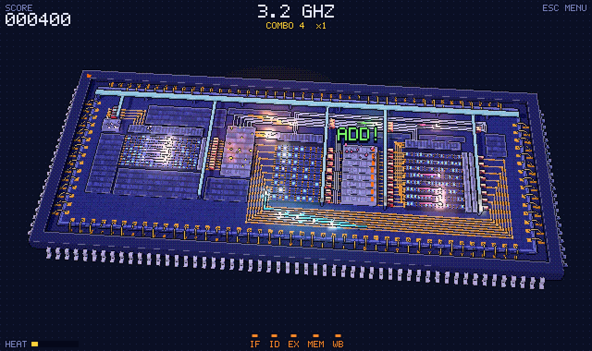
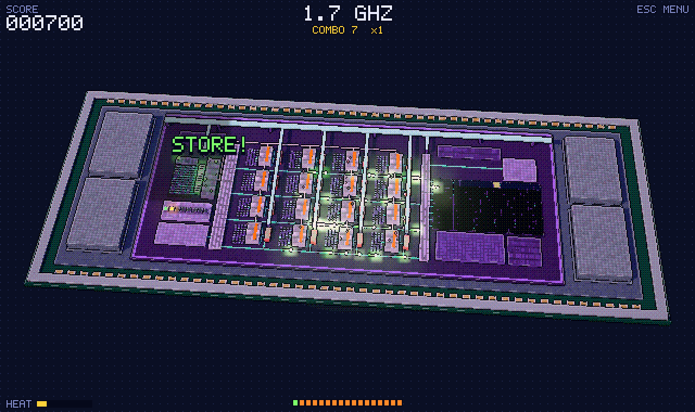

# Overclock

**You are the clock.** A pixel-art 3D arcade game about how processors really work: every tap is a clock tick, and after each tick the bits race towards the registers. Tap again when they have all arrived. Too early and the latches capture wrong bits; too late and you waste time.

**▶ Play: <https://angeloquartarone.github.io/overclock/>** — works in any modern browser, on desktop and phone, and can be installed as an app that plays offline.



*English · [Italiano](README.it.md)*

- **Too early**: the latches capture bits that haven't arrived yet. It's a glitch: you lose a life and the wrong value *really* travels on through the pipeline, into the registers or the memory, which turn red.
- **Just in time**: `PERFECT!` (within 0.1 s of the last bit arriving) or `GOOD` (within 0.3 s). The combo grows and so does the multiplier, up to ×4.
- **Too late**: `SLOW`, few points and the combo resets.

Three glitches and the processor goes `CRASH!`. Every 20 on-time ticks in a row you get a life back.

## Processors

Five processors, each with its own chip and a rule taken from how it really works. You choose after *Play*, and the chip behind the menu changes as you browse them.

| Processor | How it really works | What changes in the game | The chip |
|---|---|---|---|
| **Single-cycle** | one whole instruction per clock tick, no registers between the stages | each tick sends a single wave across the whole chip and the spotlight follows it. The rhythm is slow and uneven (0.5 to 1.1 s, LOAD with a `MISS` the longest). At the end: how long a fixed clock tuned to the slowest instruction would have taken | white ceramic DIP, gold die |
| **Multi-cycle** | each instruction is split into steps; one memory for instructions and data and one ALU, reused; the control is a state machine | one tick per step: 4 for operations (IF ID EX WB), 5 for LOAD, 4 for STORE. Five lights on the control unit show the instruction's path and the current step; the chord closes only on the last step. At the end: the CPI | grey ceramic PGA, teal die |
| **Pipeline** | five instructions at once, one per stage | the original game | QFP, blue die |
| **Microcontroller** | sleeps most of the time, runs on a battery, wakes up on interrupts | a pin lights up (`IRQ!`), the oscillator restarts and you clock the interrupt routine (the first tick fetches the vector, then 4 instructions) before the deadline, or it's `OVERRUN!` and you lose a life. After `RETI` it sleeps again: a tick while it sleeps (`ASLEEP!`) wastes battery and resets the combo. Instead of heat there's the battery: every tick drains it, more if you rush; nearly flat it slows down, at zero it's `BROWN-OUT!` | black plastic DIP, peripherals along the edge |
| **GPU** | many simple lanes run the same instruction on different data; you always wait for the slowest | each tick sends an instruction to 16 lanes that finish at different times: tap when they are all green. The shader paints a row of an image (a spaceship at sunset) into the framebuffer on the chip; eight rows make a `FRAME!` (bonus). With the "if", lanes that don't take it stay dark (divergence). A glitch leaves wrong pixels: artifacts | BGA with four HBM stacks, no gold wires |



The frequencies at the top are playful equivalents, each in its processor's unit (MHz for the older ones and the microcontroller, GHz for pipeline and GPU).

## Modes

| Mode | Rules | Ranked by |
|---|---|---|
| **Classic** | 60 seconds, 3 lives | points |
| **Sprint 50** | 50 correct instructions, 3 lives | time, only if you finish |
| **Survival** | no time limit. The *watchdog* allows a maximum delay after the bits arrive, from 1 s down to 0.28 s: exceed it and it ticks the clock for you and you lose a life | points |
| **Practice** | no lives, no timer, with the stage lights at the bottom | not saved |
| **Daily challenge** | a Classic game with the same program for everyone, changing every day, on a processor that also rotates daily. Works offline too | today's best |
| **Friend challenges** | whoever creates the challenge picks processor and mode and gets a 5-character code (or a `?sfida=CODE` link). Everyone plays the same program (needs a score server) | everyone's best in the challenge |

"The same program" means the same seed: same instructions, same initial data and same memory `MISS`es. After a glitch the data really changes, so games drift apart.

## What makes the rhythm hard (and it's all real)

| What | Why |
|---|---|
| **Sums** with many carries are slower | the ALU is a ripple-carry adder: each slice waits for the carry from the one below. `0x7F + 1` is much slower than `0x10 + 0x01`. XOR, AND and OR are fast. |
| **LOADs** depend on where the data is | far memory columns have longer wires. After 20 seconds the memory sometimes misses (`MISS!`) and you wait 0.7 s more. |
| **Heat** slows everything | the higher the frequency, the hotter the chip (orange, then red), and hot silicon is slower. Rush and the bits arrive later and later. |
| Instructions and registers matter too | the instruction to fetch and the register to read sit nearer to or farther from the latches. |
| In the GPU, the farthest lane | each lane has its own carries, and lanes far from the texture cache or the ROP receive and write later. |
| In the microcontroller, the peripheral | `IN` and `OUT` travel on the peripheral bus: the button and the timer are farther away than the ADC. |

## You play by watching the chip

- **Pipeline registers**: four rows of latches, one at the end of each stage. While the stage works the row is red, and each light above a latch turns from amber to green when its bit arrives. When the register has all its bits **the whole row turns green**. On the clock tick the latches flash white (captured) or red (captured wrong).
- **The register written back**: its column in the register file pulses amber while waiting and turns green when the result arrives.
- **The spotlight**: finished stages dim, the one still working stays lit. The chip "switches off" in waves, and when it's all in half-light it's time to tap.
- **The notes**: every stage that finishes plays its note, and when the last one finishes the chord closes. You can play by ear, too.
- **The label above the ALU**: the instruction running. `ADD!` and `SUB!` mean it probably needs more time.

For `PERFECT!` reacting isn't enough: you have to *anticipate*, watching the bits approach the registers and the carry climbing through the ALU. Add `?aiuto` to the address to get the stage lights at the bottom in every mode.

## Your results and score servers

The game always works on its own: your records and every game you play stay on your device (*Settings → Your results*). To compare scores with friends you need a **score server**, and anyone can run one: it's a single Python file with no dependencies.

- **Export**: *Settings → Export file* saves all your games in a JSON file that carries a checksum, so a server rejects it if it was edited by hand.
- **Send**: when you're logged in to a server, *Send to the server* uploads your games, and *Upload a file to the server* uploads an exported file (also someone else's, e.g. received by email). Games already there are skipped, so sending twice is harmless.
- **Connect**: games played while logged in are saved live. In *Settings → Score server* you can point the game at any server address.

> A page on HTTPS (like the GitHub Pages version) can't talk to a server on plain HTTP: browsers block it. On a local network, open the game **from the server's own address** (it serves the game too); to use a server from the web version, run it with HTTPS.

The checksum only catches hand edits: the algorithm is public, so it is not anti-cheat. The server also rejects impossible results (more points than the game allows, more instructions than time permits, inconsistent numbers). Proper anti-cheat — the server replaying the game from the recorded taps — is a possible next step.

## Running your own server

```bash
git clone https://github.com/AngeloQuartarone/overclock.git
cd overclock
python3 server.py
```

It needs only Python 3.9+ (standard library). It prints the address for this computer and for the other devices on the network, plus a QR code to scan with a phone. Everything is stored in `data/overclock.db` (SQLite): to back up, copy the file with the server stopped.

Options:

| Option | Meaning |
|---|---|
| `--port 8080` · `--host 127.0.0.1` | port (default 8765) and interface (default all; `127.0.0.1` = this computer only) |
| `--db path/other.db` | database file (default `data/overclock.db`) |
| `--registration open\|invite\|closed` | who can create an account (default `open`). With `invite` a code is needed: pass it with `--invite-code CODE` or let the server generate and print one |
| `--cors-origin https://example.org` | let another site's page use this server (repeatable). The GitHub Pages version is always allowed |
| `--cert cert.pem --key key.pem` | serve over HTTPS (TLS 1.2+) |
| `--qr` | only print the QR code of the game address and exit |

Admin commands (stop the server first, or use the same `--db`):

```bash
python3 server.py users                         # accounts, games, last seen
python3 server.py delete-user NAME              # deletes the account and its games
python3 server.py reset-password NAME           # asks for the new password (or --password)
python3 server.py delete-game ID
python3 server.py import results.json --user NAME   # import a file someone sent you, same checks as the game
```

**HTTPS on a local network** (needed for the web version to connect directly, and so passwords don't travel in clear):

```bash
openssl req -x509 -newkey rsa:2048 -nodes -days 365 \
  -keyout data/key.pem -out data/cert.pem \
  -subj "/CN=overclock" -addext "subjectAltName=IP:192.168.1.28,DNS:localhost"   # your computer's LAN address
python3 server.py --cert data/cert.pem --key data/key.pem
```

Browsers warn that a self-signed certificate isn't trusted: each player accepts it once by opening `https://<address>:8765/`. [mkcert](https://github.com/FiloSottile/mkcert) makes a certificate trusted by your own devices. `data/` is git-ignored, so the key stays private.

**Keep it running with the terminal closed** (macOS, without the Mac going to sleep while it runs):

```bash
nohup caffeinate -i python3 -u server.py >> data/server.log 2>&1 &   # start; the log goes to data/server.log
kill $(lsof -tiTCP:8765 -sTCP:LISTEN)                                 # stop
```

What the server does for security: passwords hashed with PBKDF2 (600,000 rounds, salted), session tokens stored only as hashes and expiring after 90 days of inactivity, rate limits on logins, saves and imports, a short lockout after repeated wrong passwords, strict validation of every request, plausibility checks on every result, only the game files are served (never the database or the scripts), and strict security headers (CSP, no framing, no referrer). It is designed for friends and local networks, not for the open internet: read [SECURITY.md](SECURITY.md).

## Running the game without a server

The game is static files, but ES modules don't load from `file://`, so serve the folder:

```bash
python3 -m http.server 8080    # then open http://localhost:8080/
```

## Controls

- **tap, click, space or enter**: clock tick. In menus, space and enter press the selected button
- `P` or `Esc`: pause (the game also pauses by itself if you switch tab). In menus `Esc` goes back
- `M`: sound on/off · `F`: fullscreen

Address parameters: `?sfida=ABCDE` opens that challenge · `?cpu=gpu` starts with that processor (`singolo`, `multiciclo`, `pipeline`, `mcu`, `gpu`) · `?durata=90` length of a Classic game in seconds (for testing: not saved) · `?px=3` pixel size · `?aiuto` stage lights in every mode · `?debug` exposes `window.__dbg` in the console.

## Project structure

```
index.html            page, canvas, menu style and Three.js import map
manifest.webmanifest  installable app (PWA)
sw.js                 service worker: caches the game for offline play (list generated by tools/build_sw.py)
js/main.js            game states, input, scoring, HUD, camera
js/menu.js            HTML screens: home, processors, modes, leaderboards, challenges, profile, login, settings, results, pause
js/i18n.js            English and Italian texts
js/history.js         games saved on this device, export with checksum
js/api.js             score server calls (configurable address); without a server you play offline
js/modes.js           mode rules, daily challenge, device records
js/procs.js           list of processors
js/proc-*.js          one file per processor: core geometry, simulated processor, bit timing, its lights and labels
js/isa.js             instructions shared by single-cycle, multi-cycle and pipeline, with the ripple-carry adder
js/engine.js          shared direction: travelling bits, clock edge, who arrived in time, array and latch lights
js/scene.js           the 3D chip, with the four packages (QFP, DIP, PGA, BGA with HBM)
js/pixel.js           the 8-bit look, spotlight, heat and glitch flash
js/sfx.js             8-bit sounds synthesised with Web Audio
js/font.js            5×7 bitmap font · js/qr.js QR codes · js/sha256.js SHA-256 · js/route.js bit paths and PRNG
server.py             score server: game files plus API for accounts, games, leaderboards, challenges and imports
qr.py                 QR code generator for the terminal (js/qr.js is its port)
vendor/               three.js 0.170.0 and IBM Plex Mono, self-hosted (see THIRD_PARTY_NOTICES.md)
tools/                build_sw.py (service worker file list), make_icons.py (app icons)
tests/                server tests: python3 -m unittest discover -s tests -v
```

To add a processor: a new `js/proc-*.js` with `meta`, `buildCore`, `createCPU`, `initView`, `syncView`, `anchors`, `spots` and `schedule` (plus `update`, `write`, `results` if needed), register it in `js/procs.js`, add it to `CPUS` in `server.py`, add its texts to `js/i18n.js` and run `python3 tools/build_sw.py`.

## Where difficulty is tuned

| What | Where |
|---|---|
| `PERFECT` and `GOOD` windows (0.1 s and 0.3 s), points, multiplier, lives | `js/main.js`, `clockEdge` |
| How much heat (or a flat battery) slows down, how much a tick heats or drains | `power` in each processor's `meta` (`js/proc-*.js`); cooling in `frame` in `js/main.js` |
| Time per carry slice (`SLICE`), `MISS` delay, bit speed on each path | top of each `js/proc-*.js` and its `schedule` |
| Interrupt deadlines and frequency | `js/proc-mcu.js`, `SRC` and `createCPU` |
| Classic length, Sprint target, lives | `js/modes.js` (and `SPRINT_TARGET` in `server.py`) |
| Survival watchdog (1 s → 0.28 s, −0.012 s per instruction) | `js/main.js`, `WD` |
| Daily challenge processor | `ROTATION` in `server.py` and `js/modes.js` (keep them identical) |

## Simplifications

- A late bit is always captured inverted. In a real chip the latch would keep the old value, or go metastable.
- The program avoids dependencies between nearby instructions, so there are no stalls or forwarding. That would be a good next "era" of the game.
- A red register doesn't "infect" whoever reads it: red only marks who received a wrong write.
- Single-cycle: only PC, register file and memory are clocked; delays of the stages in between are seen and heard but not captured.
- Multi-cycle: the PC has its own incrementer (like the 6502), so the ALU stays a single one for computations.
- Microcontroller: the main routine is just a `SLEEP` with *sleep-on-exit*; interrupts arrive at an interval from the end of the previous routine, so the length depends on the player and the Sprint stays fair.
- GPU: a single warp at a time, which is also one row of the image; real GPUs interleave many warps to hide memory latency.

## License

Overclock — code, graphics, processors and chip designs — is © 2026 Angelo Quartarone and is released under the [PolyForm Noncommercial License 1.0.0](LICENSE).

- ✅ You may play it, study it, modify it, run your own server and share it, for any **non-commercial** purpose (personal use, education, research, hobby projects, schools and non-profits).
- ❌ You may not use it, or its graphics, for commercial purposes without permission. For a commercial license, open an issue or contact the author via GitHub.

This makes Overclock *source-available* rather than "open source" in the OSI sense. Third-party components in `vendor/` keep their own licenses (three.js: MIT; IBM Plex Mono: SIL OFL 1.1) — see [THIRD_PARTY_NOTICES.md](THIRD_PARTY_NOTICES.md).

Security issues: see [SECURITY.md](SECURITY.md).
